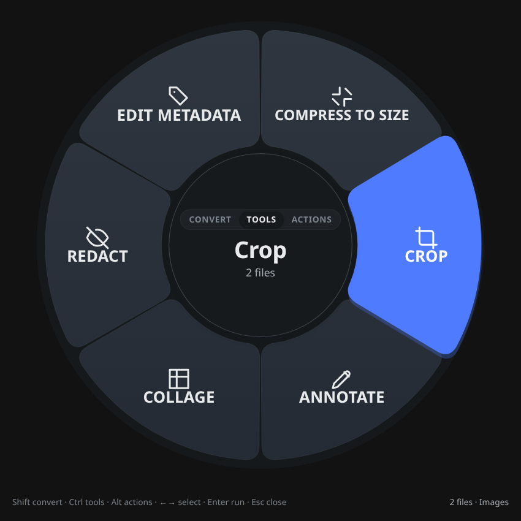
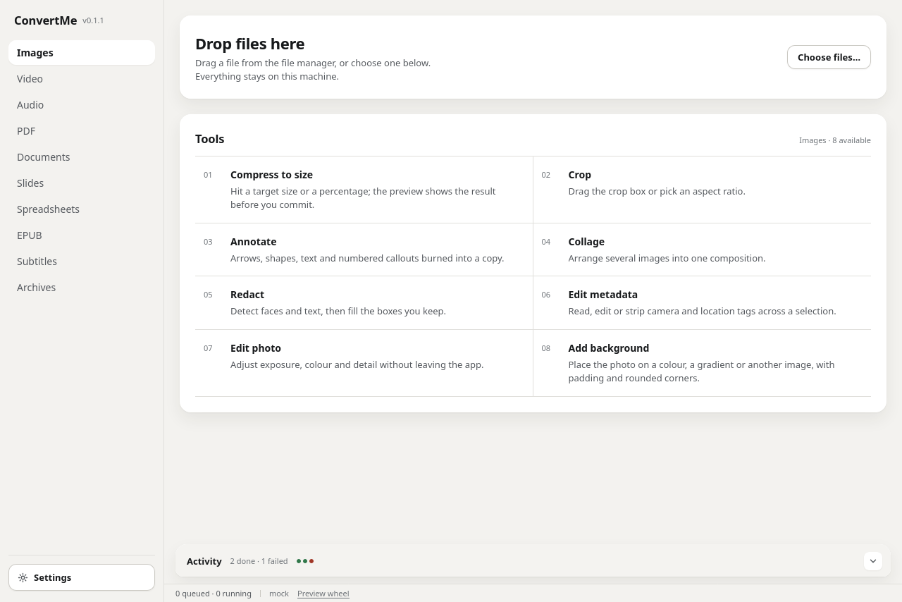
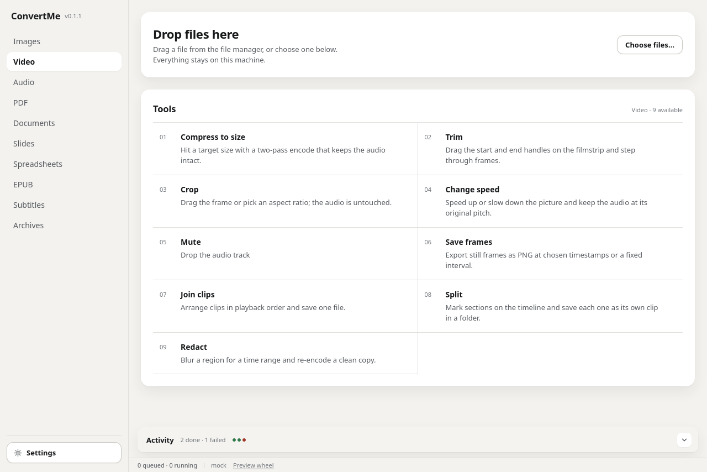
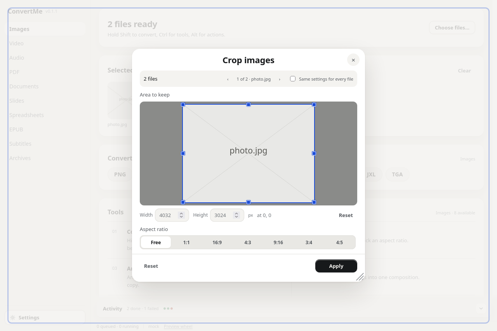
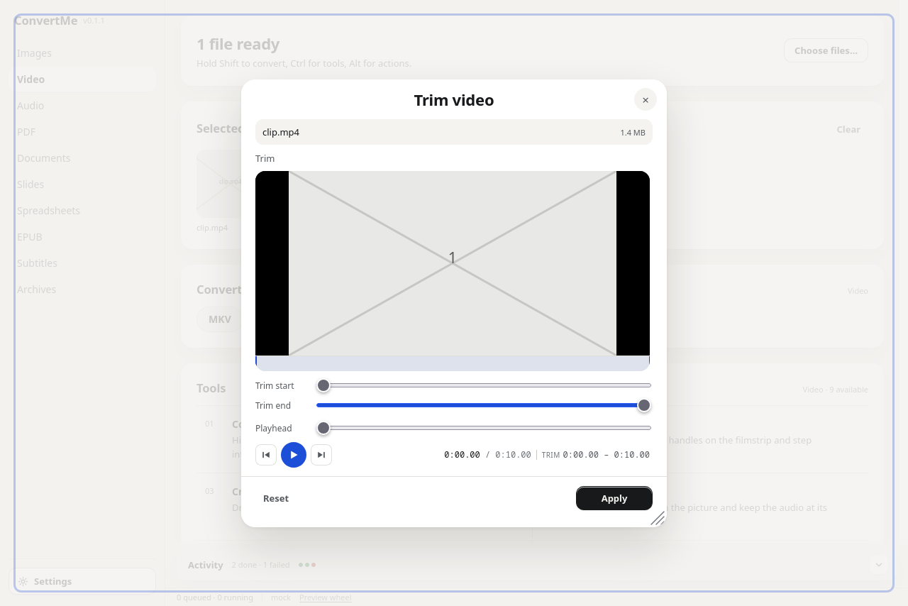

# ConvertMe

**An offline, drag-and-drop file converter with a wheel instead of a dialog maze.**

Drag files onto the window, hold a key, and a ring of choices appears under the
pointer: conversion targets on **Shift**, file tools on **Ctrl**, file actions on
**Alt**. Nothing is uploaded, and a source file is never modified — every job writes a
new file next to it.

<p align="center">
  
</p>

<p align="center">
  <a href="https://github.com/danyghraizi/convertme/actions/workflows/ci.yml"></a>
  <a href="LICENSE"></a>
</p>

> **Status.** Linux jobs are green. The Windows jobs are red on two `convertme-core`
> tests — the tree compiles there, the assertions fail — tracked in
> [#1](https://github.com/danyghraizi/convertme/issues/1). Windows packages are not
> published yet; `docs/RELEASE_READINESS.md` lists what that cell still requires.

## Install

Prebuilt Linux packages for **0.1.1** — `.deb`, `.rpm` and an AppImage — are on the
[releases page](https://github.com/danyghraizi/convertme/releases/latest). The `.deb`
and `.rpm` bundle the converters they drive, so the app works without a tool hunt.
Windows packages are not published yet; `docs/RELEASE_READINESS.md` lists what the
Windows cell still requires.

Or [build from source](#building) — it is one bundler run and one `cargo build`.

## What it does

- **311 conversion targets** across ten categories, driven by the converter you
  already have installed (FFmpeg, ImageMagick, Ghostscript/qpdf/Poppler, Pandoc,
  LibreOffice, 7-Zip, Tesseract).
- **33 file tools** that are more than a format change: crop, trim, redact a face,
  compress to a target size, join clips, merge PDFs, strip metadata.
- **One window, one job queue.** Every job is queued, cancellable, and recorded in
  Activity with the exact command line that ran.
- **Local only.** No account, no telemetry, no metering. The only network call the app
  can make is the optional update check.

## The wheel

Hold a key over a drag, or press **Preview wheel** in the status bar, and the wheel
opens loaded with the current selection. `←/→` or `↑/↓` select, `Enter` runs, `Esc`
closes, and `Shift`/`Ctrl`/`Alt` switch between the convert, tools and actions rings.
The centre of the wheel always names what is selected and how many files are in the
job, so the ring never asks you to remember what you dragged.

| | |
|---|---|
|  |  |
| **Images** — eight tools, from a target-size compress to face redaction | **Video** — trim on a filmstrip, crop, change speed, save frames, join or split |
|  |  |
| **Crop** — drag the box, type exact pixels, or pick a ratio; one file or every file in the job | **Trim** — drag the start and end handles, step frames, and keep the audio in sync |

## Tools by category

| Category | Tools |
|---|---|
| **Images** | Compress to size, Crop, Annotate, Collage, Add background, Edit photo, Edit metadata, Redact |
| **Video** | Compress to size, Trim, Crop, Change speed, Mute, Save frames, Join clips, Split, Redact |
| **Audio** | Compress, Normalize, Trim, Channels, Visualize, Bleep, Edit metadata |
| **PDF** | Compress, Organize pages, Edit metadata, Merge, Split pages, Save pages as images, Extract text |
| **Documents** | Merge |
| **Archives** | Extract |

Slides, Spreadsheets, EPUB and Subtitles contribute conversion targets rather than
tools. `convertme probe` prints the exact set your installed converters can run.

## Command line

The CLI is the same pipeline, not a second implementation:

```sh
convertme convert photo.jpg --to webp
convertme tool clip.mp4 --tool trim --params '{"start":1.5,"end":9}'
convertme probe                             # what is installed, and what it enables
convertme history --limit 20                # what ran, with the argv that ran it
```

Flags are parsed strictly: an unknown or misspelled flag is an error with the usage,
never a silently skipped word. `convertme <command> --help` prints the grammar.

## Living in the background

The wheel needs a process to hold the hook (Windows/X11) or the portal shortcut
(Wayland), so an invisible instance runs from login:

```sh
convertme --background     # no window; the wheel works from any app
convertme                  # a second launch shows and focuses the window
```

Settings → **Start with the system** writes the login entry for you
(`~/.config/autostart/app.convertme.desktop` on Linux,
`HKCU\…\CurrentVersion\Run` on Windows).

## Invariants

These are enforced by tests, not by convention:

* **Sources are read-only.** Engines that mutate by nature (`metadata`, `redact`,
  `crop`, `trim`, `bleep`, `organize`) run on a staged copy in the job's work dir;
  the queue publishes the artifact, never the engine.
* **Publish is atomic.** Everything is produced in `<tmp>/convertme-<pid>-<seq>` and
  renamed into place, so a cancel, a crash or a full disk leaves the directory
  untouched. An existing file is never replaced (`(2)` suffix), and the source path is
  never a candidate.
* **No shell strings.** Every tool invocation is an argv array, so filenames with
  spaces, quotes, newlines and emoji work.
* **Local only.** No telemetry, no metering, no network call except the optional
  update check.

## Building

```sh
cargo xtask gen-conf            # crates/convertme-gui/tauri.conf.json
cargo xtask fixtures            # one tiny file per input format
npm --prefix ui ci && npm --prefix ui run build
./sidecars/pdf/build.sh         # the Python sidecar
cargo xtask vendor --sidecar sidecars/pdf/dist/convertme-pdf
cargo build --release -p convertme-gui --bin convertme
```

`cargo build` embeds whatever `crates/convertme-gui/ui-dist` holds; it does not run
the front-end bundler. The build script refuses to compile when `ui/src` is newer than
`ui-dist`, so a stale bundle cannot reach a binary. `tauri build` (and
`scripts/bundle.sh`) run the bundler and the identity gate themselves.

The bundler runs the identity gate, which needs the token list:

```sh
export DEBRAND_TOKENS_FILE=~/.config/convertme/forbidden.txt   # one lowercase token per line
```

`./scripts/bundle.sh deb` (or `deb,rpm`) is the Linux package entry point; it requires
the pinned Ubuntu 24.04 x86_64 build environment and stops when payloads or packaging
tools are absent. AppImage builds currently fail closed until portable ELF dependencies
and Ghostscript/Tesseract data paths are proven. A local build is not clean-machine
evidence.

Windows NSIS and portable artifacts use `scripts/bundle-windows.ps1` with an explicit
MSVC target. The build requires x64 CPython 3.12, the matching Microsoft-signed offline
WebView2 installer, a verified compliance directory, and the target's pinned tool
payload. Missing or conflicting inputs stop packaging; the script does not fall back
to PATH tools.

## What is where

| Path | What it holds |
|---|---|
| `crates/convertme-core` | Identity strings, the format registry, the planner, the job queue, naming and publish rules, subtitles |
| `crates/convertme-engines` | One module per tool family: ImageMagick, FFmpeg, Ghostscript/qpdf/Poppler, Pandoc/LibreOffice, 7-Zip, metadata, redaction, previews |
| `crates/convertme-drag` | The only platform-specific code: Windows hooks, X11 keymap polling, the Wayland global-shortcuts portal |
| `crates/convertme-gui` | The Tauri shell, the wheel window, the actions, and the CLI |
| `ui/` | Vite + SolidJS front end, including the wheel geometry |
| `sidecars/pdf` | `convertme-pdf`, the Python sidecar for PDF → DOCX/PPTX/XLSX/EPUB |
| `scripts/` | The identity gate, the Tauri config generator, the icon generator, the acceptance harnesses |
| `xtask` | `cargo xtask fixtures\|vendor\|snapshot\|perf\|release\|gen-conf\|debrand` |

## Licensing

GPL-3.0-or-later. The bundled tools and their licences are listed in `NOTICE`; any
bundled build's corresponding source is published with the package on the releases
page, and the sidecar's source is `sidecars/pdf/` in this repository.

## Contributing

The canonical home is <https://github.com/danyghraizi/convertme>. Start with
`CONTRIBUTING.md` for the build order and the preflight command, and `AGENTS.md` for
the invariants a change must keep. Security reports go through `SECURITY.md`, not the
issue tracker. Participation is covered by the Contributor Covenant in
`CODE_OF_CONDUCT.md`.

The repository contains source and the release implementation, not release inputs or
packages: a clone builds the application, and `docs/RELEASE_READINESS.md` records what
a signed Linux/Windows package additionally requires.

## Working notes

`AGENTS.md` lists the rules that keep this tree honest (build, the UI/backend field
contract, engine hygiene, how to verify a change). `docs/LESSONS.md` records the
failures that produced them, with the measurements that exposed each one.

The screenshots above are produced by `scripts/ui-shots.py`, which drives the built
front end in headless Firefox against the development mock: the components and layout
are real, the file data is fixture data.
